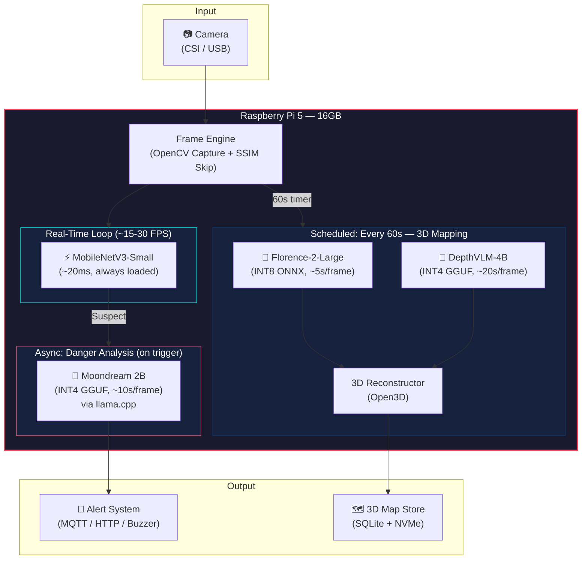
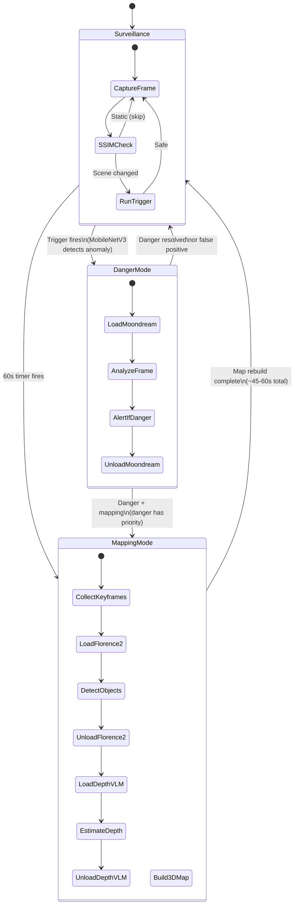
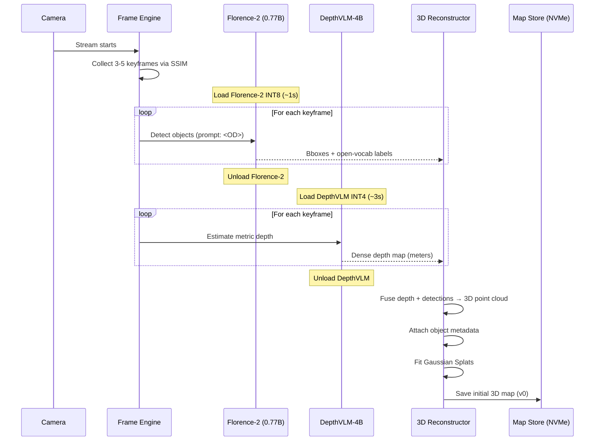
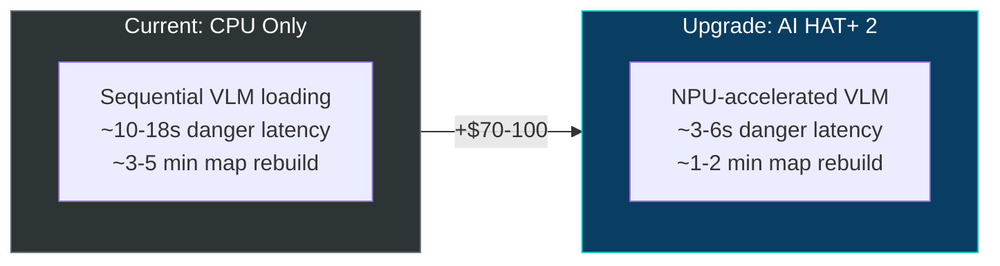
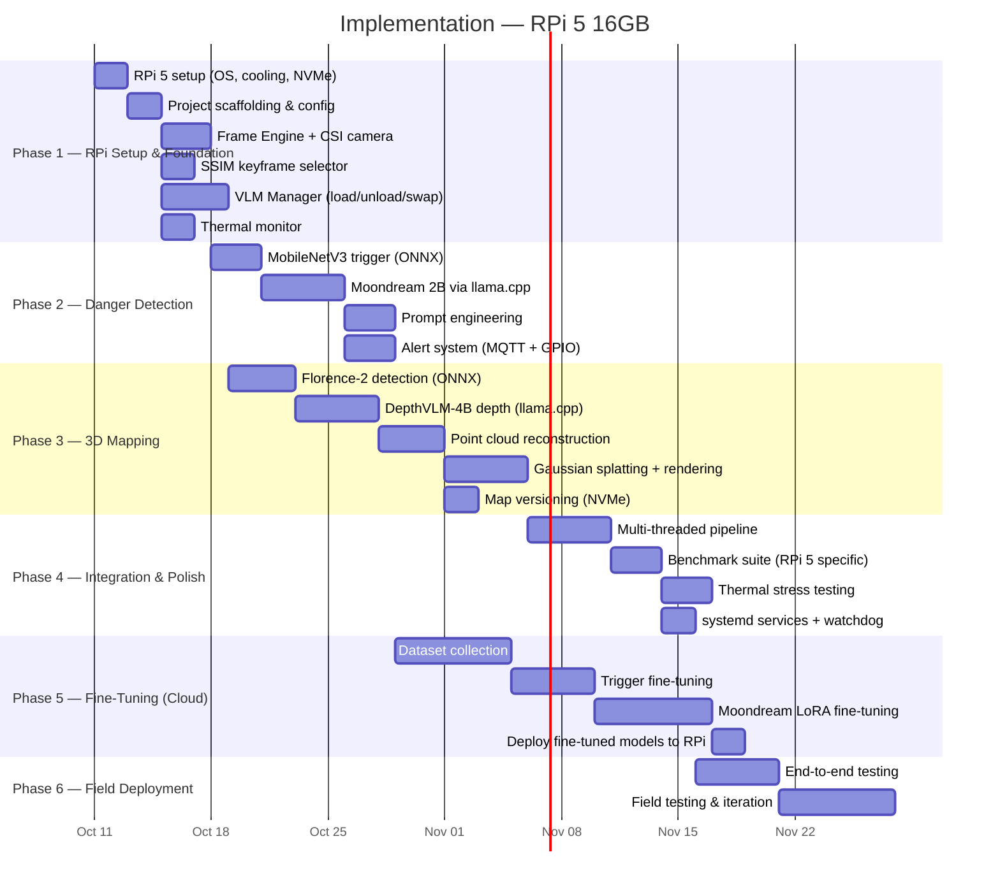

# 🛡️ VLM-Based Danger Detection & 3D Mapping System — Design Plan v3
## Target Hardware: Raspberry Pi 5 (16GB)

> [!IMPORTANT]
> This plan is **specifically tailored for the Raspberry Pi 5 16GB**. All inference estimates, memory budgets, and optimization strategies reflect real-world RPi 5 constraints — **CPU-only inference, no dedicated GPU, ~34 GB/s memory bandwidth**.

---

## 1. Hardware Setup — Mandatory Requirements

```
┌─────────────────────────────────────────────────────────────┐
│                  Raspberry Pi 5 (16GB)                      │
│                                                             │
│  CPU:  Quad-core ARM Cortex-A76 @ 2.4 GHz                  │
│  RAM:  16 GB LPDDR4X (shared — no dedicated VRAM)           │
│  BW:   ~34 GB/s memory bandwidth                            │
│  GPU:  VideoCore VII (NOT usable for ML inference)          │
│                                                             │
│  MANDATORY ACCESSORIES:                                     │
│  ✅ Active Cooler (sustained inference WILL thermal throttle)│
│  ✅ 27W USB-C Power Supply (official)                       │
│  ✅ NVMe SSD via PCIe HAT (model loading from SD = 5-10x   │
│     slower; SSD eliminates I/O bottleneck)                  │
│  ✅ CSI / USB Camera Module                                 │
│                                                             │
│  OPTIONAL (Recommended):                                    │
│  ⭐ AI HAT+ 2 (Hailo-10H) — 40 TOPS + 8GB onboard RAM     │
│     → Enables 3-5x VLM inference speedup                   │
│     → Has dedicated memory, freeing system RAM              │
└─────────────────────────────────────────────────────────────┘
```

> [!WARNING]
> **Without active cooling**, sustained VLM inference will cause CPU thermal throttling within 60–90 seconds, degrading performance by 30–50%. The active cooler is **non-negotiable**.

---

## 2. System Architecture (RPi 5 Optimized)

### 2.1 VLM Model Stack

| Role | Model | Params | Quantization | RAM (Quantized) | Inference per Frame (RPi 5 CPU) |
|------|-------|--------|-------------|-----------------|-------------------------------|
| 🔥 **Danger Analysis** | Moondream 2B | ~1.8B | INT4 (GGUF) | ~1.2 GB | ~8–15 seconds |
| 📦 **Object Detection** | Florence-2-Large | ~0.77B | INT8 (ONNX) | ~0.5 GB | ~3–7 seconds |
| 📐 **Depth Estimation** | DepthVLM-4B | ~4B | INT4 (GGUF) | ~2.5 GB | ~15–25 seconds |
| ⚡ **Danger Trigger** | MobileNetV3-Small | ~2.5M | INT8 (ONNX) | ~5 MB | ~15–30 ms |

> [!NOTE]
> **Reality check on RPi 5**: VLM inference is measured in **seconds per frame**, not frames per second. The architecture is designed around this constraint — aggressive frame skipping, asynchronous processing, and the trigger model running at real-time to gate expensive VLM calls.

### 2.2 Architecture Diagram



---

## 3. RPi 5 Inference Strategy

### 3.1 Three Operating Modes

The system operates in **three distinct modes** to manage the CPU-only constraint:



### 3.2 Inference Engine Selection (RPi 5 Specific)

| Model | Inference Engine | Format | Why |
|-------|-----------------|--------|-----|
| **Moondream 2B** | `llama.cpp` | GGUF (Q4_K_M) | Best ARM CPU optimization; efficient memory management; fastest for autoregressive VLMs |
| **Florence-2-Large** | ONNX Runtime | ONNX (INT8) | Excellent ARM64 support; split encoder/decoder for caching; IOBindings for zero-copy |
| **DepthVLM-4B** | `llama.cpp` | GGUF (Q4_K_M) | Handles 4B params efficiently on CPU; memory-mapped file loading |
| **MobileNetV3-Small** | ONNX Runtime | ONNX (INT8) | Sub-30ms; always resident in RAM |

### 3.3 Realistic Timing Budget

```
┌──────────────────────────────────────────────────────────────┐
│           Timing Budget — One Complete Cycle                 │
├──────────────────────────────────────────────────────────────┤
│                                                              │
│  CONTINUOUS SURVEILLANCE LOOP (Real-Time):                   │
│  ├── Frame capture:                    ~5 ms                 │
│  ├── SSIM comparison:                  ~2 ms                 │
│  ├── MobileNetV3 trigger:              ~20 ms                │
│  └── Total per frame:                  ~27 ms (~35 FPS)      │
│                                                              │
│  DANGER ANALYSIS (When triggered — async):                   │
│  ├── Load Moondream INT4 from NVMe:    ~2-3 s                │
│  ├── Moondream inference:              ~8-15 s               │
│  ├── Unload + alert:                   ~0.5 s                │
│  └── Total danger response:            ~10-18 s              │
│                                                              │
│  3D MAP REBUILD (Every 60 seconds):                          │
│  ├── Collect 5-8 keyframes:            ~0 s (already cached) │
│  ├── Load Florence-2 (INT8):           ~1-2 s                │
│  ├── Florence-2 × 5 keyframes:         ~15-35 s              │
│  ├── Unload Florence-2:                ~0.5 s                │
│  ├── Load DepthVLM-4B (INT4):          ~3-5 s                │
│  ├── DepthVLM × 5 keyframes:           ~75-125 s             │
│  ├── Unload DepthVLM:                  ~0.5 s                │
│  ├── 3D reconstruction (Open3D):       ~5-10 s               │
│  └── Total map rebuild:                ~100-180 s            │
│                                                              │
│  ⚠️  Map rebuild takes ~2-3 minutes on CPU.                  │
│     During this time, the trigger still runs in a            │
│     separate thread for danger detection.                    │
└──────────────────────────────────────────────────────────────┘
```

> [!CAUTION]
> The 3D mapping cycle exceeds 60 seconds on CPU-only RPi 5. Options:
> 1. **Increase map interval** to every 3–5 minutes (recommended)
> 2. **Reduce keyframes** from 5 to 2–3 per cycle
> 3. **Add AI HAT+ 2** for 3–5x speedup (brings it under 60s)
> 4. **Use fewer depth frames** — depth on 2 keyframes, detection on all

---

## 4. Memory Budget (16GB RPi 5)

```
┌──────────────────────────────────────────────────────────────┐
│               Memory Budget — 16 GB RPi 5                    │
│            Sequential VLM Loading Strategy                    │
├──────────────────────────────────────────────────────────────┤
│                                                              │
│  ALWAYS RESIDENT:                                            │
│  ├── Raspberry Pi OS (headless):       ~0.4 GB               │
│  ├── Python Runtime + OpenCV:          ~0.3 GB               │
│  ├── MobileNetV3 Trigger (INT8):       ~0.01 GB              │
│  ├── Frame Buffers (30 frames):        ~0.15 GB              │
│  ├── Keyframe Cache (10 frames):       ~0.05 GB              │
│  └── Subtotal always resident:         ~0.9 GB               │
│                                                              │
│  LOADED ON DEMAND (only ONE at a time):                      │
│  ├── Moondream 2B (INT4 GGUF):         ~1.2 GB              │
│  │   OR                                                      │
│  ├── Florence-2-Large (INT8 ONNX):     ~0.5 GB              │
│  │   OR                                                      │
│  ├── DepthVLM-4B (INT4 GGUF):          ~2.5 GB              │
│                                                              │
│  ACTIVE DURING MAPPING:                                      │
│  ├── 3D Map Buffer (Open3D):           ~0.5 GB               │
│  ├── Depth maps in memory:             ~0.2 GB               │
│  └── Gaussian Splat params:            ~0.3 GB               │
│                                                              │
│  ═══════════════════════════════════════                      │
│  PEAK USAGE (during mapping with DepthVLM):                  │
│  0.9 + 2.5 + 1.0 = ~4.4 GB                                  │
│                                                              │
│  AVAILABLE HEADROOM: ~11.6 GB                                │
│  → Plenty of room for OS services, logging, etc.             │
│  → Could potentially load 2 smaller VLMs concurrently        │
└──────────────────────────────────────────────────────────────┘
```

> [!TIP]
> With 16GB, you have **significant headroom**. You could even keep Florence-2 (0.5GB) always resident alongside the trigger model, and only swap Moondream/DepthVLM on demand. This eliminates Florence-2 load/unload latency.

---

## 5. Detailed Pipeline Flow

### 5.1 Initialization (Camera Connect)



### 5.2 Continuous Operation

```mermaid
graph TD
    subgraph SurveillanceThread["Thread 1: Surveillance (Always Running)"]
        A["Capture Frame"] --> B["SSIM Check"]
        B -->|"Changed"| C["MobileNetV3 Trigger (~20ms)"]
        B -->|"Static"| A
        C -->|"Safe"| A
        C -->|"Suspect"| D["Signal Danger Thread"]
        D --> A
    end

    subgraph DangerThread["Thread 2: Danger Analysis (On Signal)"]
        E["Receive signal + frame"] --> F["Load Moondream 2B"]
        F --> G["VLM Analysis (~10s)"]
        G --> H{"Danger?"}
        H -->|"Yes"| I["🚨 ALERT + JSON metadata"]
        H -->|"No"| J["Log false positive"]
        I --> K["Unload Moondream"]
        J --> K
    end

    subgraph MapThread["Thread 3: Mapping (Every 3-5 min)"]
        L["Timer fires"] --> M["Check: Is danger thread active?"]
        M -->|"Yes"| N["Wait for danger to finish"]
        M -->|"No"| O["Run mapping cycle"]
        N --> O
        O --> P["Florence-2: Detect objects"]
        P --> Q["DepthVLM: Estimate depth"]
        Q --> R["Rebuild 3D map"]
        R --> S["Save to NVMe"]
    end

    style SurveillanceThread fill:#0d1b2a,stroke:#00cec9,color:#fff
    style DangerThread fill:#1b263b,stroke:#e94560,color:#fff
    style MapThread fill:#1b263b,stroke:#0f3460,color:#fff
```



---

## 6. Project Structure

```
vlm_danger_system/
├── config/
│   ├── default.yaml                 # All tuneable hyperparams
│   └── rpi5_16gb.yaml               # RPi 5 specific: intervals, quantization, threads
│
├── src/
│   ├── __init__.py
│   ├── main.py                      # Entrypoint & orchestrator
│   │
│   ├── core/
│   │   ├── __init__.py
│   │   ├── pipeline.py              # Multi-threaded pipeline orchestration
│   │   ├── scheduler.py             # Map rebuild scheduler (configurable interval)
│   │   ├── vlm_manager.py           # VLM load/unload/swap manager (RPi memory-aware)
│   │   └── config.py                # Config loader & validator
│   │
│   ├── capture/
│   │   ├── __init__.py
│   │   ├── frame_engine.py          # Camera capture (CSI/USB) + preprocessing
│   │   ├── keyframe_selector.py     # SSIM-based keyframe extraction
│   │   └── camera_registry.py       # Multi-camera management
│   │
│   ├── detection/
│   │   ├── __init__.py
│   │   ├── trigger.py               # MobileNetV3 fast classifier (always loaded)
│   │   ├── vlm_danger.py            # Moondream 2B — danger analysis via llama.cpp
│   │   ├── danger_classifier.py     # Post-processing & severity classification
│   │   └── prompts.py               # VLM prompt templates
│   │
│   ├── mapping/
│   │   ├── __init__.py
│   │   ├── vlm_object_detector.py   # Florence-2 — VLM object detection via ONNX
│   │   ├── vlm_depth_estimator.py   # DepthVLM-4B — VLM depth via llama.cpp
│   │   ├── reconstructor.py         # 3D point cloud builder (Open3D)
│   │   ├── gaussian_splatter.py     # Gaussian splatting for frame re-rendering
│   │   └── map_store.py             # Versioned map persistence (NVMe)
│   │
│   ├── alerting/
│   │   ├── __init__.py
│   │   ├── alert_manager.py         # Alert dispatch logic
│   │   ├── backends/
│   │   │   ├── mqtt_backend.py      # MQTT alerts (lightweight, IoT-native)
│   │   │   ├── http_backend.py      # HTTP webhook alerts
│   │   │   ├── gpio_buzzer.py       # RPi GPIO buzzer/LED alert
│   │   │   └── email_backend.py     # Email notifications
│   │   └── alert_types.py           # Alert severity definitions
│   │
│   ├── optimization/
│   │   ├── __init__.py
│   │   ├── quantizer.py             # Quantization helpers (GGUF, ONNX INT8)
│   │   ├── vlm_manager.py           # Model swap orchestrator (memory-mapped loading)
│   │   ├── thermal_monitor.py       # RPi CPU temperature monitoring + throttle detection
│   │   └── profiler.py              # Latency, memory, temp profiling
│   │
│   └── utils/
│       ├── __init__.py
│       ├── logger.py                # Structured logging (structlog)
│       ├── metrics.py               # FPS, latency, memory, CPU temp tracking
│       └── visualization.py         # Debug visualization tools
│
├── models/                          # Downloaded model files (on NVMe SSD)
│   ├── moondream2-q4_k_m.gguf      # Moondream 2B quantized
│   ├── florence2_large_int8.onnx    # Florence-2 ONNX
│   ├── depthvlm-4b-q4_k_m.gguf     # DepthVLM quantized
│   └── mobilenetv3_small_int8.onnx  # Trigger model
│
├── data/
│   ├── maps/                        # Versioned 3D map snapshots
│   └── logs/                        # Alert logs, metrics, thermal logs
│
├── scripts/
│   ├── setup_rpi5.sh                # One-click RPi 5 setup (deps, cooling check)
│   ├── download_models.py           # Download + quantize all models
│   ├── benchmark_rpi5.py            # RPi 5 specific benchmark suite
│   ├── convert_to_gguf.py           # PyTorch → GGUF conversion
│   ├── convert_to_onnx.py           # PyTorch → ONNX conversion
│   ├── finetune_trigger.py          # Fine-tune MobileNetV3
│   ├── finetune_moondream.py        # LoRA fine-tune Moondream
│   └── thermal_stress_test.py       # Test sustained inference thermal behavior
│
├── tests/
│   ├── test_frame_engine.py
│   ├── test_danger_pipeline.py
│   ├── test_florence2_detection.py
│   ├── test_depthvlm_estimation.py
│   ├── test_vlm_manager.py          # Test model swapping
│   ├── test_3d_mapping.py
│   ├── test_thermal_monitor.py
│   └── test_alert_system.py
│
├── systemd/
│   ├── vlm-danger.service           # Auto-start on boot
│   └── vlm-danger-watchdog.service  # Watchdog for crash recovery
│
├── requirements.txt
├── pyproject.toml
└── README.md
```

---

## 7. 3D Mapping — VLM-Powered (RPi 5 Adapted)

### 7.1 Pipeline

```
Camera Frame
    │
    ├──► Florence-2-Large (VLM, INT8 ONNX)
    │    prompt: "<OD>"
    │    ──► Open-vocabulary bboxes + labels (~5s/frame on RPi 5)
    │
    ├──► DepthVLM-4B (VLM, INT4 GGUF)
    │    ──► Dense metric depth map in meters (~20s/frame on RPi 5)
    │        (unified focal length normalization — no calibration)
    │
    └──────────────►  3D Point Cloud Builder (Open3D)
                              │
                              ├── Per-object 3D metadata:
                              │   • Label (open-vocabulary from Florence-2)
                              │   • 3D coordinates (x, y, z) in meters
                              │   • Estimated size (w, h, d)
                              │   • Depth from camera (from DepthVLM)
                              │   • Confidence score
                              │
                              ▼
                     Gaussian Splatting Fit
                              │
                              ▼
                     Versioned Map Snapshot
                     (stored to NVMe every 3-5 min)
```

### 7.2 Data Schema

```python
from dataclasses import dataclass, field
from typing import List, Optional, Tuple
from datetime import datetime
import numpy as np

@dataclass
class Object3D:
    """A detected object with 3D spatial information from VLMs."""
    label: str                                      # Open-vocab label (Florence-2)
    confidence: float                               # Detection confidence
    position: Tuple[float, float, float]            # (x, y, z) meters
    dimensions: Tuple[float, float, float]          # (w, h, d) meters
    depth_from_camera: float                        # Metric depth (DepthVLM)
    bbox_2d: Tuple[int, int, int, int]              # [x1, y1, x2, y2]

@dataclass
class SceneMap:
    """3D scene representation, rebuilt every 3-5 minutes on RPi 5."""
    version: int
    timestamp: datetime
    camera_id: str
    point_cloud: np.ndarray                         # (N, 3) metric 3D points
    depth_maps: List[np.ndarray]                    # Metric depth from DepthVLM
    objects: List[Object3D]                          # Detected objects with 3D info
    gaussian_params: Optional['GaussianSplatData']  # For re-rendering
    camera_intrinsics: 'CameraIntrinsics'
    build_duration_seconds: float                   # Track rebuild time
    cpu_temp_during_build: float                    # Monitor thermal state
```

---

## 8. Danger Detection — VLM Prompt Design

### 8.1 Moondream Prompts

```python
# Primary danger classification
DANGER_ANALYSIS_PROMPT = """
Analyze this camera frame for dangerous situations.
Classify: SAFE, SMOKE, FIRE, CONFLICT, OTHER_DANGER.
If dangerous, respond in JSON:
{"type": "...", "location": "...", "severity": "LOW|MEDIUM|HIGH|CRITICAL", "action": "..."}
"""

# Native detection (uses Moondream's built-in .detect())
DANGER_OBJECTS = "fire, smoke, flames, weapon, fighting"

# Follow-up (if danger persists across frames)
FOLLOWUP_PROMPT = """
Previous frame showed {danger_type}. In this new frame:
1. Escalating or de-escalating?
2. People near the danger?
Respond in JSON.
"""
```

### 8.2 Response Matrix

| Category | Severity | Alert Target | RPi-Specific |
|----------|----------|-------------|--------------|
| 🔥 Fire | HIGH→CRITICAL | MQTT + GPIO buzzer + HTTP | ~10-18s detection latency |
| 💨 Smoke | MEDIUM→HIGH | MQTT + HTTP | ~10-18s detection latency |
| ⚔️ Conflict | MEDIUM→CRITICAL | MQTT + HTTP | ~10-18s detection latency |
| ⚠️ Other | LOW→HIGH | MQTT | ~10-18s detection latency |

> [!NOTE]
> **10-18 second danger detection latency** is the reality on RPi 5 CPU. If sub-second response is required, consider the AI HAT+ 2 upgrade path (see Section 11).

---

## 9. Optimization — RPi 5 Specific

### 9.1 Model Quantization

| Model | Original | Format | Quantization | Size on Disk | RAM at Runtime |
|-------|----------|--------|-------------|-------------|----------------|
| **Moondream 2B** | ~7 GB | GGUF | Q4_K_M | ~1.1 GB | ~1.2 GB |
| **Florence-2-Large** | ~3 GB | ONNX | INT8 static | ~0.4 GB | ~0.5 GB |
| **DepthVLM-4B** | ~16 GB | GGUF | Q4_K_M | ~2.3 GB | ~2.5 GB |
| **MobileNetV3-Small** | ~10 MB | ONNX | INT8 | ~5 MB | ~5 MB |

### 9.2 RPi 5 Optimization Techniques

| Technique | What | Why It Matters on RPi 5 |
|-----------|------|------------------------|
| **GGUF + llama.cpp** | Memory-mapped model loading | Loads from NVMe without copying entire model to RAM; instant swap |
| **ONNX IOBindings** | Zero-copy tensor I/O | Eliminates host↔device copying overhead; critical on shared memory |
| **SSIM Frame Skipping** | Skip static frames | Reduces VLM calls by 70-90% in typical surveillance |
| **NVMe SSD** | Fast model loading | Model load from SSD: ~1-3s; from SD card: ~10-30s |
| **Headless OS** | No desktop environment | Saves ~400 MB RAM and ~15% CPU |
| **CPU Affinity** | Pin inference to cores 2-3 | Reserve cores 0-1 for camera + trigger; avoid contention |
| **Memory Mapping** | mmap for GGUF models | Kernel manages paging; models larger than free RAM still work |
| **Thermal Monitoring** | Watch CPU temp in-loop | Auto-throttle inference rate if temp > 80°C |
| **Batch Keyframes** | Process N frames per model load | Amortize the 1-5s model load cost across multiple frames |

### 9.3 Threading Model

```python
# RPi 5 threading strategy — 4 cores
#
# Core 0: Surveillance thread (camera capture + SSIM + trigger)
# Core 1: Alert + logging + scheduling
# Core 2-3: VLM inference (llama.cpp / ONNX Runtime uses both)
#
# Only ONE VLM inference runs at a time.
# Danger analysis PREEMPTS mapping.

import threading
from multiprocessing import cpu_count

SURVEILLANCE_CORES = [0]      # Dedicated to real-time capture
SERVICE_CORES = [1]           # Alerts, logging, scheduling  
INFERENCE_CORES = [2, 3]      # VLM inference (llama.cpp uses 2 threads)
```

---

## 10. RPi 5 Specific Configuration

```yaml
# config/rpi5_16gb.yaml

hardware:
  platform: "rpi5_16gb"
  cpu_cores: 4
  ram_gb: 16
  storage: "nvme"            # MUST be NVMe for acceptable model load times
  cooling: "active"          # MANDATORY

capture:
  resolution: [640, 480]     # Lower resolution = faster VLM inference
  fps: 30
  camera_type: "csi"         # or "usb"

surveillance:
  ssim_threshold: 0.92       # Skip frames with < 8% change
  trigger_model: "mobilenetv3_small_int8.onnx"
  trigger_confidence: 0.6    # Low threshold → high recall

danger:
  model: "moondream2-q4_k_m.gguf"
  engine: "llama_cpp"
  threads: 2                 # Use cores 2-3
  max_response_tokens: 256
  temperature: 0.1           # Low temp for deterministic JSON output

mapping:
  interval_seconds: 300      # 5 minutes (realistic for RPi 5 CPU)
  keyframes_per_cycle: 3     # Balance quality vs compute time
  
  object_detection:
    model: "florence2_large_int8.onnx"
    engine: "onnx_runtime"
    task_prompt: "<OD>"
  
  depth_estimation:
    model: "depthvlm-4b-q4_k_m.gguf"
    engine: "llama_cpp"
    threads: 2

thermal:
  warning_temp_c: 75
  throttle_temp_c: 80        # Pause non-critical inference above this
  critical_temp_c: 85        # Pause ALL inference; alert operator

logging:
  level: "INFO"
  output: "data/logs/"
  max_size_mb: 100
```

---

## 11. Upgrade Path: AI HAT+ 2 (Hailo-10H)

> [!TIP]
> If the ~10-18s danger latency or ~3-5 min mapping cycle is unacceptable, the **Raspberry Pi AI HAT+ 2** is the recommended upgrade. It was designed specifically for VLM inference on RPi 5.

| Feature | CPU Only | With AI HAT+ 2 |
|---------|---------|----------------|
| **Cost** | $0 (included) | ~$70-100 USD |
| **TOPS** | ~2 (CPU) | 40 (NPU) + CPU |
| **Dedicated Memory** | None (shared 16GB) | 8 GB LPDDR4X onboard |
| **Moondream 2B inference** | ~8-15s | ~2-4s |
| **Florence-2 inference** | ~3-7s | ~1-2s |
| **DepthVLM inference** | ~15-25s | ~4-8s |
| **Map rebuild (3 keyframes)** | ~100-180s | ~25-50s |
| **Danger response time** | ~10-18s | ~3-6s |
| **Can run 2 VLMs concurrently** | No | Potentially (NPU + CPU) |



The system is designed so that adding the AI HAT+ 2 requires **only configuration changes** (switching inference engine from `llama_cpp`/`onnx_runtime` to `hailo_runtime`), not code rewrites.

---

## 12. Fine-Tuning Plan

### 12.1 MobileNetV3 Trigger

| Aspect | Detail |
|--------|--------|
| **Where to train** | Desktop GPU / cloud (NOT on RPi 5) |
| **Dataset** | FASDD + violence datasets + safe-scene negatives |
| **Export** | PyTorch → ONNX INT8 → deploy to RPi 5 |
| **Target** | >95% recall, ~15% false positive rate |

### 12.2 Moondream 2B (Danger VLM)

| Aspect | Detail |
|--------|--------|
| **Method** | LoRA (rank 16) on Query module |
| **Where** | Cloud / desktop GPU (A100/4090) |
| **Dataset** | ~5,000 fire/smoke/conflict images + JSON QA pairs |
| **Export** | Fine-tuned → GGUF Q4_K_M → deploy to RPi 5 |

---

## 13. Phased Roadmap



---

## 14. Risk Analysis — RPi 5 Specific

| Risk | Likelihood | Impact | Mitigation |
|------|-----------|--------|------------|
| **10-18s danger latency too slow** | High | High | AI HAT+ 2 upgrade; or use Moondream 0.5B (~2-5s) at cost of accuracy |
| **CPU thermal throttling** | High | Medium | Active cooler (mandatory); thermal monitor auto-pauses inference |
| **DepthVLM-4B too slow (~20s/frame)** | High | Medium | Reduce to 2 depth frames per cycle; or use DepthLM approach with smaller VLM |
| **Model load/unload overhead** | Medium | Medium | NVMe SSD (mandatory); memory-mapped GGUF; keep Florence-2 always resident |
| **3D map rebuild exceeds interval** | High | Low | Increase interval to 5 min; reduce keyframes; accept lower map freshness |
| **SD card I/O bottleneck** | High | High | NVMe SSD is **mandatory**, not optional |
| **VLM hallucination** | Medium | High | Confidence thresholds; human-in-the-loop for CRITICAL |
| **Power supply instability** | Low | Critical | 27W official PSU; UPS recommended for production |

---

## 15. Open Questions

1. **Danger latency**: Is 10-18 seconds acceptable, or do you need sub-5s? (determines AI HAT+ 2 requirement)
2. **Map rebuild interval**: 3-5 minutes OK, or must it be exactly 1 minute? (1 min requires AI HAT+ 2)
3. **Camera type**: CSI camera module or USB webcam? CSI is lower latency on RPi.
4. **AI HAT+ 2**: Budget for the ~$70-100 accelerator? It transforms the system's responsiveness.
5. **Connectivity**: Does the RPi have network access for MQTT alerts, or fully offline?
6. **Alert output**: MQTT? GPIO buzzer? HTTP webhook? Email? All of the above?
7. **Boot behavior**: Should the system auto-start on RPi boot via systemd?
8. **Moondream 0.5B fallback**: Acceptable to use 0.5B (faster, ~2-5s) instead of 2B for danger if latency is critical?
